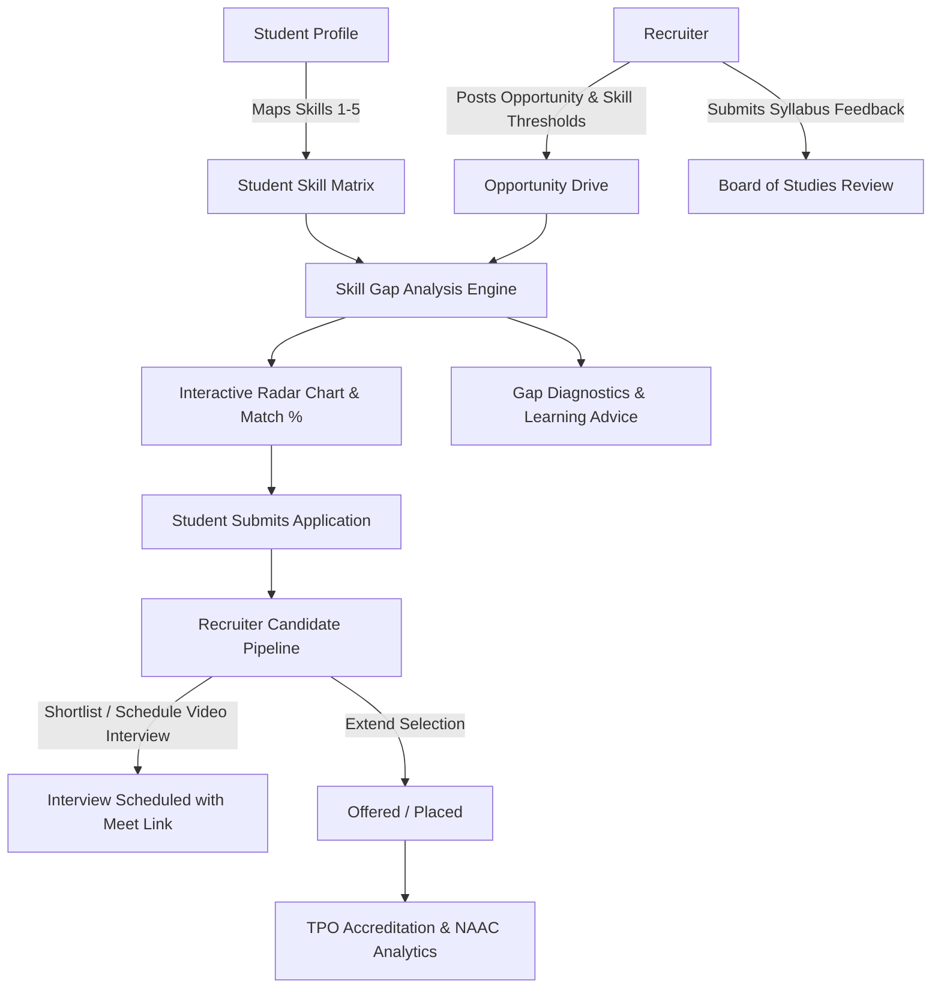

# Project Report: Portal for Academia - Industry Collaboration for Skill Mapping, Internships and Placement
**Topic Number:** 55 (PB-55)  
**Academic Coursework / Assessment:** Continuous Assessment (CA3 / CA33)  
**Technology Stack:** Python 3.14, Django 6.1, SQLite3, Bootstrap 5.3, Chart.js  

---

## 1. Executive Summary
The **Portal for Academia - Industry Collaboration for Skill Mapping, Internships and Placement** is a full-stack, enterprise-grade web application engineered to bridge the communication and competency gap between higher education institutions, undergraduate/postgraduate students, and corporate recruiters. 

### Core Challenges Solved:
1. **The Skill Disconnect**: Traditional university curricula often lag behind rapidly evolving industry tech stacks (e.g., containerization, microservices, vector search, cloud-native deployments).
2. **Opaque Placement Matching**: Conventional placement portals rank students solely on CGPA, failing to quantify whether a student possesses hands-on practical skills required for a specialized role.
3. **Lack of Institutional Feedback Loop**: Corporate feedback regarding the quality or gaps of graduating candidates rarely reaches the university Board of Studies (BoS) in a structured manner.
4. **Accreditation Burden**: Gathering verified records of active industry Memorandums of Understanding (MoUs), corporate-sponsored Capstones, and placement ratios for accreditation bodies (NAAC Criteria 3 & 5, NBA Criterion 10) is typically manual and error-prone.

---

## 2. Stakeholder User Roles & Capabilities

| Role | Target Persona | Key Capabilities & Features |
|---|---|---|
| **Student** | Enrolled engineering/computing student | Profile management, 5-level technical self-rating with certificate links, automated resume skill extraction, interactive Radar skill-gap diagnostic against job descriptions, 1-click internship & placement drive applications, and interview link tracking. |
| **Industry Recruiter** | Corporate HR, University Relations Lead | Post internship and campus placement opportunities, define mandatory skill requirements with benchmark proficiency thresholds, review applicants auto-ranked by skill compatibility score, schedule video interviews (Google Meet / Zoom), extend offers, and submit syllabus recommendations to academic departments. |
| **Faculty / TPO** | Head of Training & Placement, Department HOD | College-wide KPI dashboard (placement percentage, average stipend/CTC, active drives), drive approvals/vetting, student skill certificate verification, review corporate syllabus feedback for Board of Studies, and export NAAC/NBA compliance reports. |
| **Administrator** | Institutional IT Admin | Central database administration via Django Admin panel (`/admin`), master skill taxonomy maintenance, and user management. |

---

## 3. Mathematical Skill-Matching Formulation

To provide an objective compatibility score between candidate competencies and corporate job descriptions, the system implements a bounded weighted ratio:

$$\text{Match Score (\%)} = \min\left(100, \left( \frac{\sum_{i=1}^{N} \min(S_i, R_i)}{\sum_{i=1}^{N} R_i} \right) \times 100 \right)$$

Where:
- $N$ is the total number of required skills for the opportunity.
- $R_i \in [1, 5]$ is the minimum expected proficiency demanded by the recruiter for skill $i$.
- $S_i \in [0, 5]$ is the student's verified or self-rated proficiency level for skill $i$.
- $\min(S_i, R_i)$ prevents over-proficiency in one domain from artificially masking deficits in other required domains.

### Skill Gap Calculation:
$$\Delta_i = S_i - R_i$$
- If $\Delta_i \ge 0$, the student meets or exceeds the corporate bar.
- If $\Delta_i < 0$, a skill gap of $|\Delta_i|$ levels is detected, triggering an automated recommendation for specific certification or project work.

---

## 4. Database Architecture & Data Models

### 1. `core.UserProfile`
Extends Django's `auth.User` with role-based polymorphism:
- `role`: `STUDENT`, `RECRUITER`, `FACULTY_TPO`, `ADMIN`
- Academic fields: `roll_number`, `department`, `graduation_year`, `cgpa`, `resume_link`, `github_link`, `linkedin_link`
- Corporate fields: `company_name`, `company_website`, `company_sector`, `designation`, `company_address`
- Faculty fields: `employee_id`, `faculty_department`

### 2. `skills.SkillCategory` & `skills.Skill`
- Organizes competencies into structured domains: *Programming & Core CS*, *Web & Mobile*, *Cloud, DevOps & Systems*, *AI, ML & Data Science*, and *Soft Skills*.
- `industry_demand_index`: A normalized market index (0–100) reflecting real-time recruitment demand.

### 3. `skills.StudentSkill`
- M:N relation between `UserProfile` and `Skill` with `proficiency` (1 to 5), `certificate_name`, `certificate_url`, `is_verified` (Boolean), and `verified_by` (FK to Faculty).

### 4. `internships.Opportunity` & `OpportunitySkillRequirement`
- Supports Summer Internships, Semester Internships, and Full-Time Placement Drives.
- Stores location, work mode (Remote/Hybrid/On-Site), stipend/CTC, minimum CGPA, eligible branches, and deadline.
- Child table `OpportunitySkillRequirement` binds required skills with threshold levels and `is_mandatory` flags.

### 5. `internships.Application`
- Tracks student applications through the hiring lifecycle: `APPLIED` $\to$ `UNDER_REVIEW` $\to$ `SHORTLISTED` $\to$ `INTERVIEW_SCHEDULED` $\to$ `OFFERED` or `REJECTED`.
- Stores `match_score`, `cover_letter`, `interview_link`, `interview_date`, and `recruiter_notes`.

### 6. `collaboration.CollaborationProject` & `CurriculumFeedback` & `IndustryMoU`
- Manages corporate-sponsored Capstones with student team size limits and stipend funding.
- Provides a formal channel for recruiters to flag outdated course curricula to the Board of Studies.
- Logs active institutional corporate MoUs with validity dates and legal focus areas.

---

## 5. Key System Workflows

---

## 6. Viva Voce & Presentation Defense Questions

#### Q1: Why did you choose Django for this project?
**Answer:** Django provides an enterprise-ready Model-View-Template (MVT) architecture with a built-in ORM, secure authentication engine, CSRF/XSS protection, and a production-grade admin panel. This allowed rapid modeling of complex many-to-many relationships (students to skills, jobs to required proficiencies) while maintaining zero external database configuration overhead using SQLite.

#### Q2: How does the Skill Gap Analyzer work?
**Answer:** The analyzer compares a student's verified skills against the required skills of a selected job posting. It computes the percentage match using a bounded ratio formula and generates dynamic JSON data rendered into an interactive Chart.js Radar Chart. It highlights matching strengths in green and flags skill deficits in red with targeted learning recommendations.

#### Q3: How does the portal facilitate NAAC and NBA accreditation?
**Answer:** NAAC Criterion 3.5 requires documented evidence of active industry collaborations and MoUs. Criterion 5.2 requires verified student placement records. The portal includes an institutional **Analytics & Audit Cell** that tracks active MoUs, calculates branch-wise placement percentages, and exports these records as structured CSV/PDF reports with one click.

#### Q4: How is the resume extraction feature implemented?
**Answer:** The system uses regular expression token matching against the master taxonomy dictionary. When a student pastes resume or project text, the engine extracts recognized technical competencies, checks for synonyms (e.g., K8s for Kubernetes, ML for Machine Learning), compares against the student's existing profile, and enables one-click bulk mapping.

---

## 7. Instructions for Project Demonstration

1. **Launch Server**: Run `./run.sh` (or `python3 manage.py runserver 0.0.0.0:8080`).
2. **Access URL**: Open `http://localhost:8080/`.
3. **Student Flow**:
   - Log in using the **Demo Student (Rohan)** button.
   - Click **Skill Gap Analyzer** from the top menu to view the Radar Chart.
   - Navigate to **Resume Extractor**, paste sample project descriptions, and click **Extract Skills**.
   - Browse **Internships & Placements** and apply to open positions.
4. **Recruiter Flow**:
   - Log in using the **Demo Recruiter (Google)** button.
   - Go to **Manage Applicants** to view applicants sorted by match percentage.
   - Schedule an interview, input a Google Meet link, and update candidate statuses.
5. **TPO Flow**:
   - Log in using the **Demo Faculty / TPO Head** button.
   - Go to **Accreditation Analytics** to view placement distribution charts and click **Download CSV Report**.
